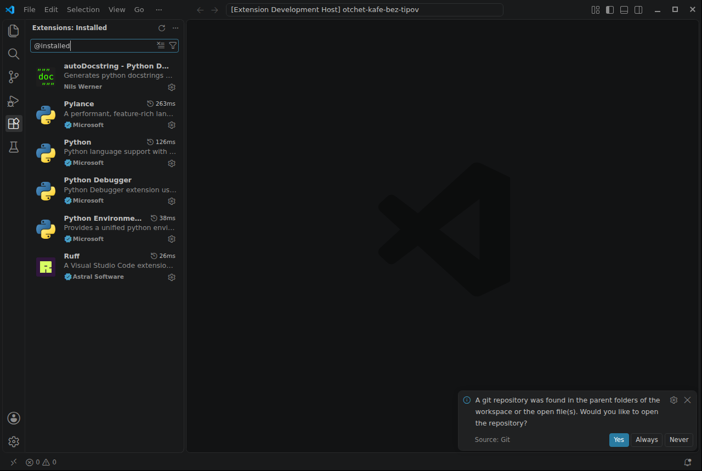
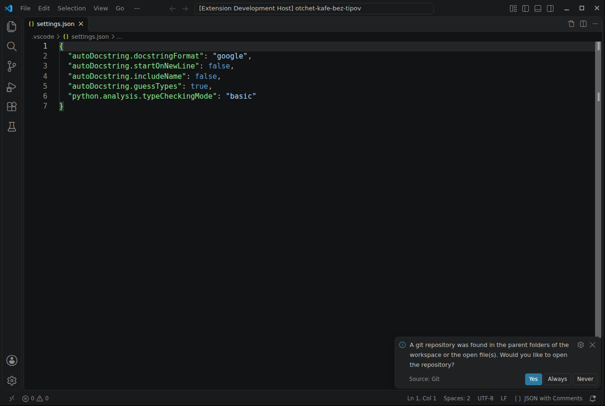
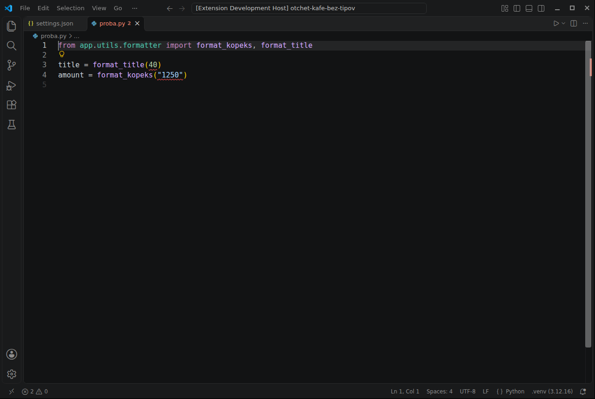
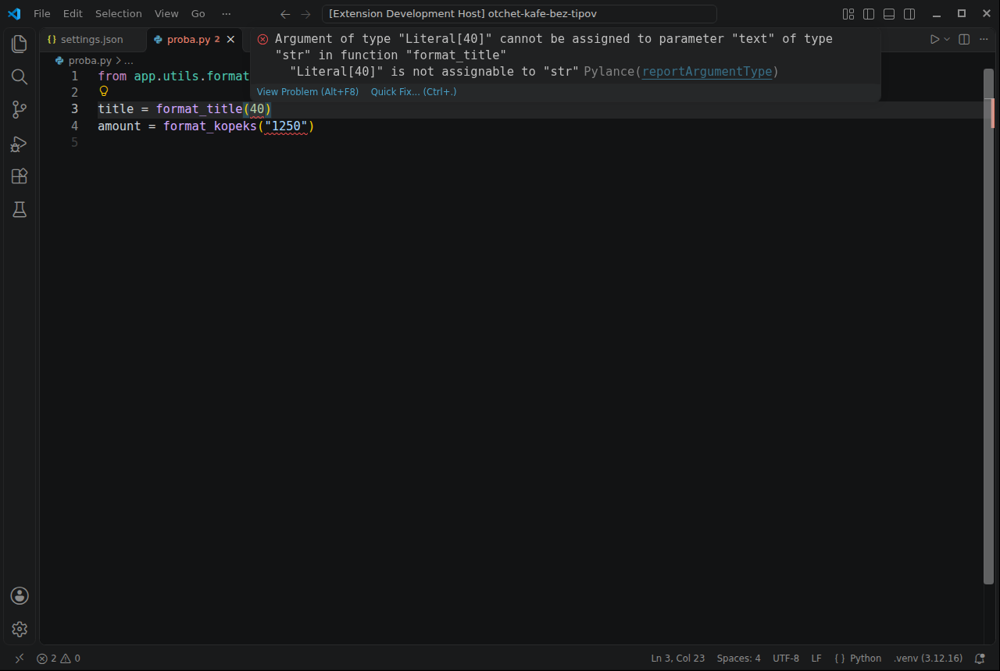
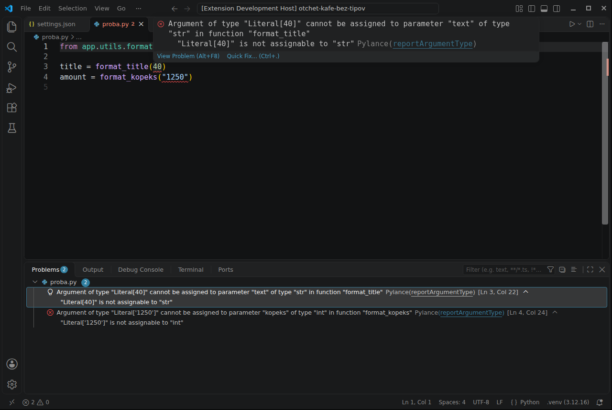
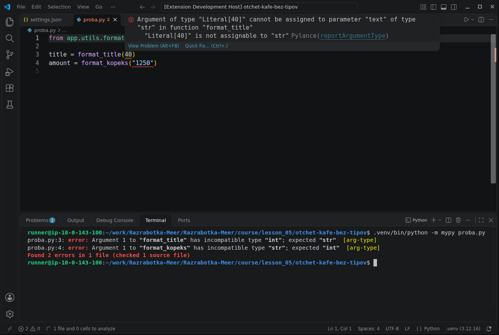
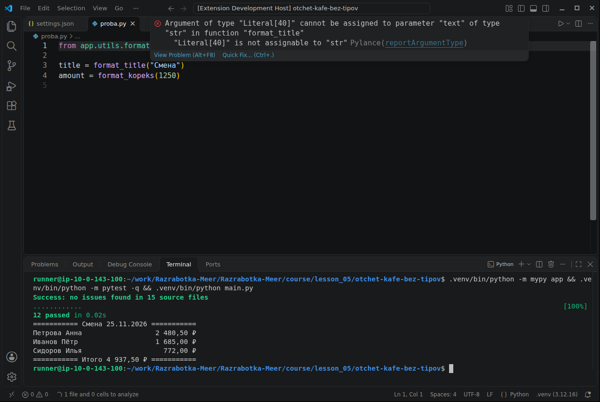

# Отчёт · Проверка типов: Pylance и mypy

**Студент:** Меер Джонатан, группа 9/2-РПО-25/2

## 1. Подготовка





## 2. Проверка в редакторе

```python
from app.utils.formatter import format_kopeks, format_title

title = format_title(40)
amount = format_kopeks("1250")
```





Разбор сообщения:

| Часть сообщения | Что означает |
|---|---|
| `Literal[40]` | Передано целое число 40. |
| `text: str` | Заголовок должен быть строкой. |
| `reportArgumentType` | Тип аргумента расходится с подписью функции. |



## 3. Проверка в терминале

```text
proba.py:3: error: Argument 1 to "format_title" has incompatible type "int"; expected "str"  [arg-type]
proba.py:4: error: Argument 1 to "format_kopeks" has incompatible type "str"; expected "int"  [arg-type]
Found 2 errors in 1 file (checked 1 source file)
```



```text
Success: no issues found in 1 source file
```

## 4. Проект без аннотаций

| Этап | Итог `mypy app` |
|---|---|
| исходно | Found 17 errors in 10 files (checked 15 source files) |
| после `utils` | Found 12 errors in 7 files (checked 15 source files) |
| после `domain` | Found 8 errors in 5 files (checked 15 source files) |
| после `services` | Found 1 error in 1 file (checked 15 source files) |
| после `ui` | Success: no issues found in 15 source files |

Модуль до и после — `app/utils/formatter.py`:

```python
def format_kopeks(kopeks):
def format_title(text, width=40):
```

```python
def format_kopeks(kopeks: int) -> str:
def format_title(text: str, width: int = 40) -> str:
```

```text
Success: no issues found in 15 source files
............                                                             [100%]
12 passed in 0.03s
=========== Смена 25.11.2026 ===========
Петрова Анна                  2 480,50 ₽
Иванов Пётр                   1 685,00 ₽
Сидоров Илья                    772,00 ₽
=========== Итого 4 937,50 ₽ ===========
```



## 5. Выводы

Pylance показывает несовпадение типов при редактировании. Mypy также находит функции без аннотаций, если включить соответствующую настройку. Проверка типов пропустит неверную формулу, если типы аргументов и результата соблюдены. Поэтому расчёт выручки дополнительно проверен тестами.
